# ShopHub · 全栈电商平台

**Vue 3 + Django REST Framework，实现从商品浏览到订单履约的购物流程。**

ShopHub 是一个前后端分离的电商作品项目，围绕商品、购物车、订单与库存展开。除了商城界面，项目还实现了下单时的事务处理、订单状态约束、取消后的库存恢复，以及基于 Celery 的待支付订单超时检查。

前端采用深色科技风格，提供桌面与移动端布局；普通用户完成购物与订单操作，管理员维护商品并处理发货。支付使用模拟接口，不涉及真实资金交易。

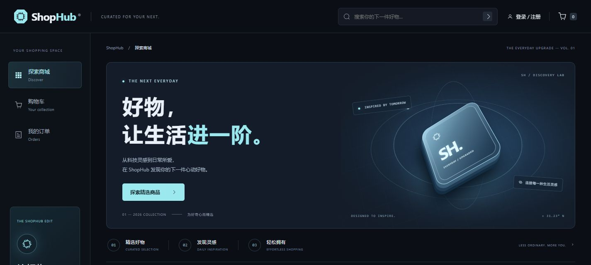

[界面预览](#界面预览) · [核心设计](#核心设计) · [系统架构](#系统架构) · [演示流程](#演示流程) · [本地运行](#本地运行) · [运行与部署指南](docs/SETUP.md) · [前端开发说明](frontend/README.md)

## 项目概览

| 关注点     | 项目中的实现                                                            |
| ---------- | ----------------------------------------------------------------------- |
| 业务流程   | 浏览商品 → 加入购物车 → 创建订单 → 模拟支付 → 管理员发货 → 用户确认收货 |
| 库存处理   | 加入购物车时检查库存；创建订单时扣减库存；取消待支付订单时恢复库存      |
| 数据一致性 | 下单、支付、取消等关键写操作使用数据库事务与行锁                        |
| 异步处理   | 订单事务提交后投递 Celery 延迟任务，检查并取消仍未支付的订单            |
| 访问控制   | JWT 认证、用户订单归属校验、管理员商品与发货权限                        |
| 前端工程   | 路由懒加载、组件按需注册、统一请求层、分页适配、加载与错误状态          |
| 运行方式   | Docker Compose 运行 Django、Celery、Nginx；PostgreSQL、Redis 单独准备   |

## 界面预览

以下截图直接来自项目现有页面。为展示完整界面，商品插画、价格、库存、账号及订单使用隔离环境中的示例数据；不对应真实商品或交易，也不代表真实后端联调结果。点击图片可查看原图。

### 商城首页

统一导航、科技感首页视觉、商品卡片、分类、排序与库存状态。

[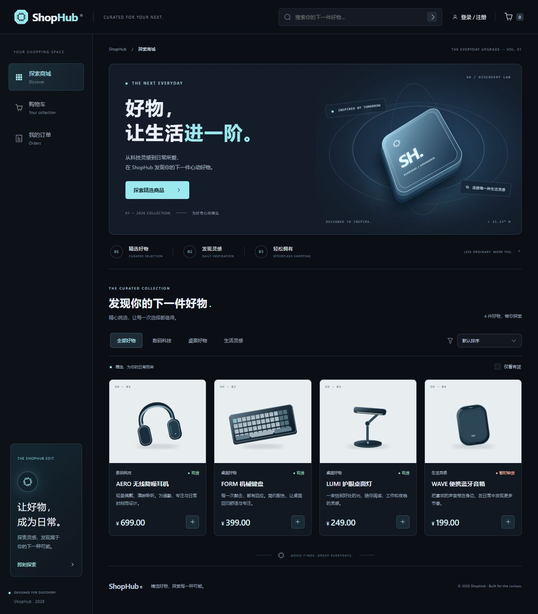](docs/screenshots/home-desktop.jpg)

### 购物与账号

| 商品详情：图片、价格、库存与购买数量                                                    | 购物车：商品明细、数量与金额汇总                                  |
| --------------------------------------------------------------------------------------- | ----------------------------------------------------------------- |
| [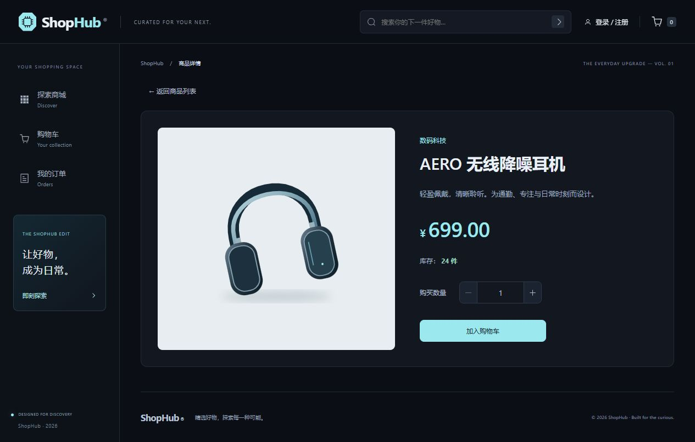](docs/screenshots/product-detail.jpg) | [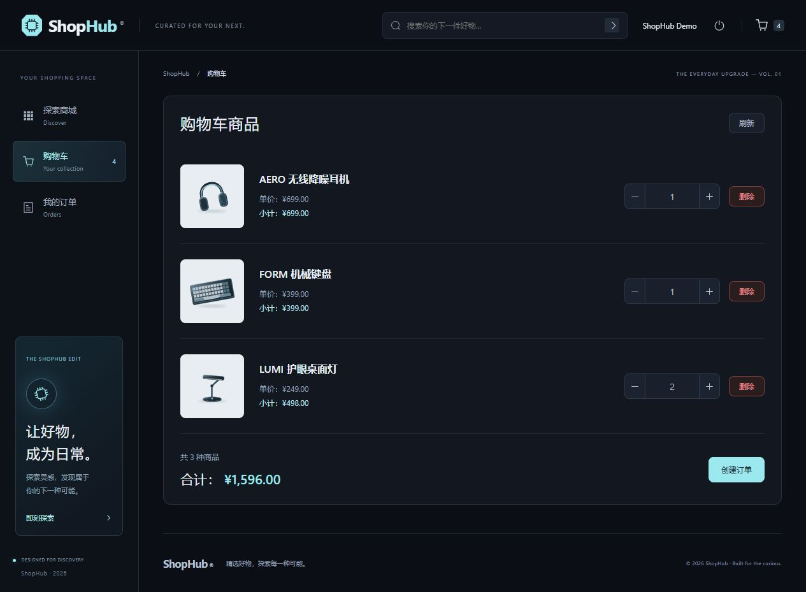](docs/screenshots/cart.jpg) |

| 订单列表：按状态筛选并查看详情                                          | 订单详情：状态进度、商品快照与操作                                                  |
| ----------------------------------------------------------------------- | ----------------------------------------------------------------------------------- |
| [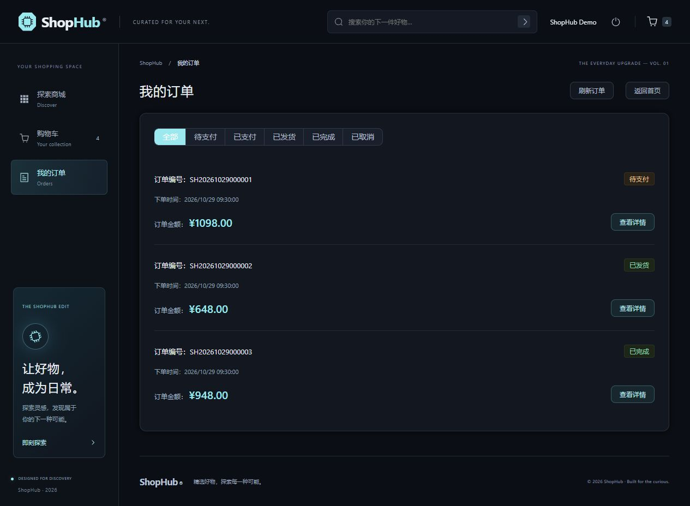](docs/screenshots/orders.jpg) | [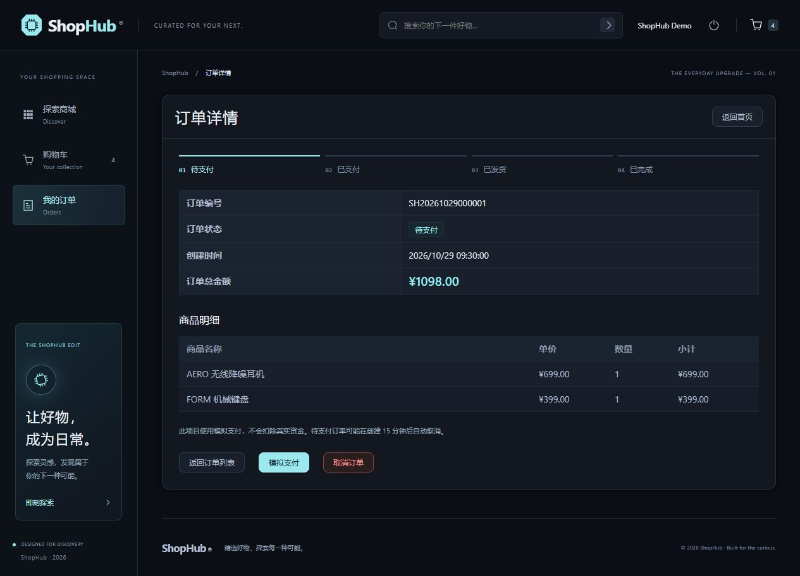](docs/screenshots/order-detail.jpg) |

| 登录：账号表单与统一主题                                              | 商品管理：搜索、库存、上下架与编辑入口                                                  |
| --------------------------------------------------------------------- | --------------------------------------------------------------------------------------- |
| [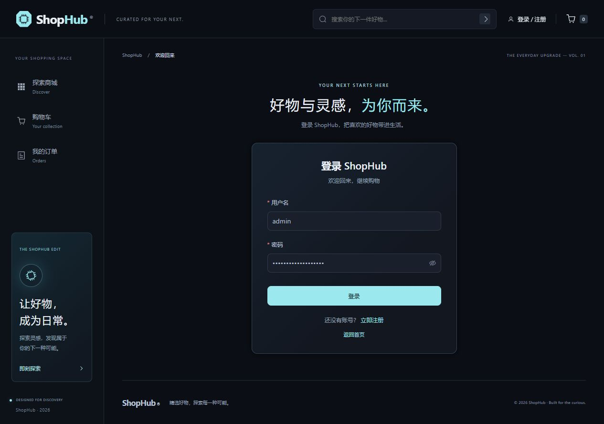](docs/screenshots/login.jpg) | [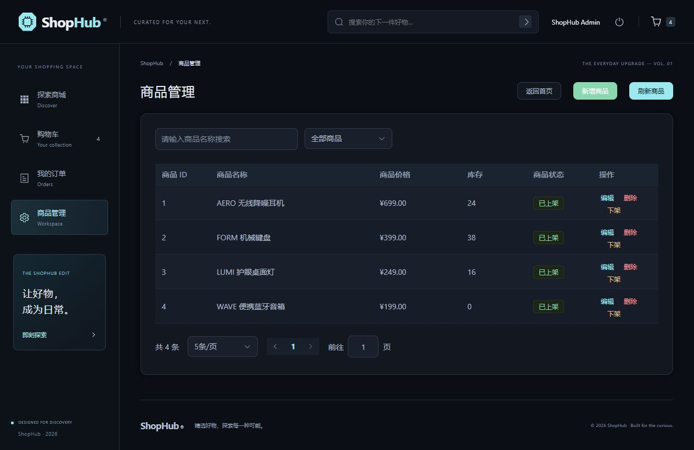](docs/screenshots/product-manage.jpg) |

<details>
<summary>查看手机端效果（390 px）</summary>

移动端使用折叠导航、双列商品卡片与纵向购物车布局。

| 手机端商城首页                                                                                                                         | 手机端购物车                                                                                                                         |
| -------------------------------------------------------------------------------------------------------------------------------------- | ------------------------------------------------------------------------------------------------------------------------------------ |
| <a href="docs/screenshots/mobile-home.jpg">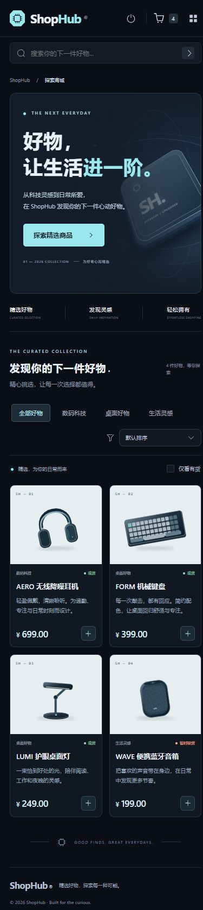</a> | <a href="docs/screenshots/mobile-cart.jpg">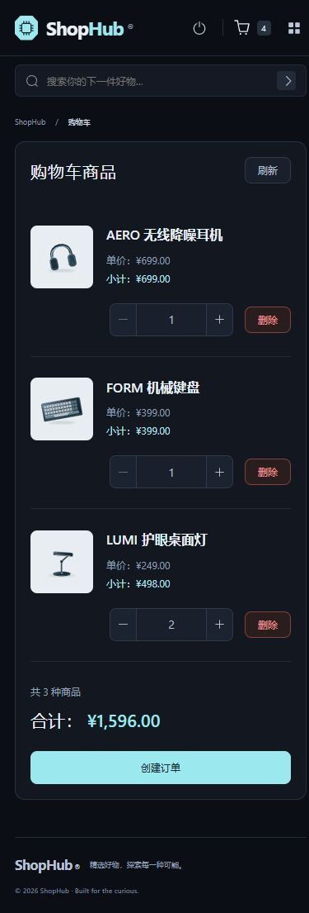</a> |

</details>

[浏览完整截图集与页面说明](docs/screenshots/README.md)

## 功能与角色

| 模块     | 游客 / 普通用户                                                  | 管理员                                                               |
| -------- | ---------------------------------------------------------------- | -------------------------------------------------------------------- |
| 商品浏览 | 公开浏览、搜索、分类、价格排序、现货筛选、详情与分页             | 同左                                                                 |
| 账号     | 注册、登录、退出；登录后返回原访问页面                           | 使用带 `is_staff` 身份的账号登录                                     |
| 购物车   | 登录后添加、修改数量、移除商品、查看金额并下单                   | 同左                                                                 |
| 订单     | 查看自己的订单，支付或取消自己的待支付订单，确认自己的已发货订单 | 可查看全部订单，为已支付订单发货；支付、取消、收货操作仍校验订单归属 |
| 商品管理 | 公开浏览已上架商品                                               | 新增、编辑、删除、上下架、上传图片、查看未上架商品                   |
| 分类管理 | 浏览分类                                                         | 通过 Django Admin 创建和维护分类                                     |

前端路由守卫负责访问引导，后端独立执行身份与数据权限校验。隐藏入口不作为权限控制的唯一依据。

## 系统架构

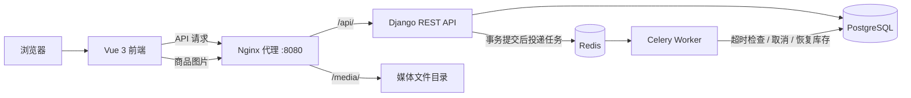

开发时，前端由 Vite 独立提供服务，`/api` 与 `/media` 默认代理到 Nginx。当前 Compose 管理 `backend`、`celery`、`nginx` 三个服务；前端静态托管、PostgreSQL 与 Redis 需独立配置。Redis 在本项目中承担任务消息代理和结果后端的职责。

| 层级       | 技术                                      | 用途                             |
| ---------- | ----------------------------------------- | -------------------------------- |
| 前端       | Vue 3、Vue Router、Vite                   | 页面、路由、构建与开发代理       |
| 交互与请求 | Element Plus、Axios                       | 表单、弹窗、表格与 HTTP 请求     |
| API        | Django、Django REST Framework、Simple JWT | 数据接口、序列化、认证和权限     |
| 数据       | PostgreSQL、Django ORM                    | 关系数据、事务、行锁和数据库约束 |
| 异步任务   | Celery、Redis                             | 待支付订单延迟检查               |
| 运行环境   | Docker Compose、Nginx                     | 后端容器编排、接口代理与媒体访问 |
| 前端测试   | Node.js 内置测试运行器                    | 分页与媒体地址工具的单元测试     |

具体版本见 [requirements.txt](requirements.txt) 和 [frontend/package-lock.json](frontend/package-lock.json)。

## 核心设计

### 1. 下单事务与库存扣减

创建订单时，接口以购物车中的商品为基础，从数据库读取最新价格和库存，重新计算订单金额。

1. 使用 `transaction.atomic` 包裹下单操作，锁定当前用户的购物车及购物车条目。
2. 按商品 ID 排序并通过 `select_for_update()` 锁定相关商品，校验上架状态、购买数量和库存。
3. 创建订单与订单明细，扣减商品库存，清空本次下单的购物车条目。
4. 数据库事务成功提交后，再投递订单超时任务。

这些数据库写入处于同一事务内；校验失败时不继续创建订单。商品金额以服务端数据为准，金额计算使用 `Decimal`。行锁用于协调并发库存写入，按固定顺序获取商品锁以降低锁顺序不一致带来的风险。

源码：[OrderCreateView](orders/views.py)。

### 2. 订单状态与重复操作保护

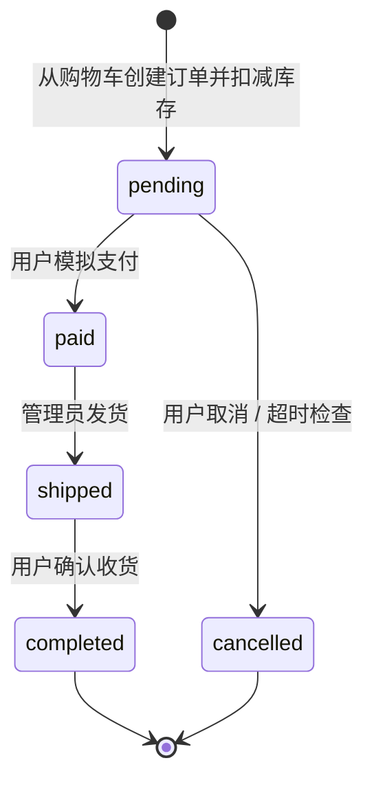

后端分别校验每种操作允许的起始状态：只有 `pending` 可以支付或取消，只有 `paid` 可以发货，只有 `shipped` 可以确认收货。支付时记录 `paid_at`。状态变更前锁定订单，避免支付与取消并发时同时改写同一状态。

手动取消和超时任务复用 `cancel_pending_order()`：锁定订单后再次检查是否仍为 `pending`，满足条件才恢复库存并变更状态。再次执行时，已取消订单不会重复恢复库存。

源码：[订单操作接口](orders/views.py)、[取消订单服务](orders/services.py)。

### 3. 事务提交后安排超时检查

下单接口通过 `transaction.on_commit()` 注册任务投递逻辑，使用 Celery `apply_async(countdown=...)` 安排延迟检查，当前超时配置为 **15 分钟**。这样可以避免数据库事务尚未提交，任务就尝试读取新订单。

任务触发时会重新读取订单状态；若用户已支付，取消服务直接返回，不恢复库存。该机制依赖 Redis 和 Celery Worker 正常运行，15 分钟表示任务安排的等待时间，实际执行时间还受队列与 Worker 状态影响。

源码：[任务投递](orders/views.py)、[超时任务](orders/tasks.py)、[超时配置](config/settings.py)。

### 4. 订单快照与数据库约束

订单明细保存下单时的 `product_name`、`price`、`quantity`、`subtotal`。后续商品改名或调价，不会改变已保存的历史明细。明细对商品使用 `SET_NULL` 外键策略，商品删除后仍保留订单中的名称与价格快照。

模型同时定义了以下数据库约束：

- 同一购物车与商品组合唯一，避免产生重复条目。
- 订单总金额、订单明细价格与小计不能为负数。
- 订单明细数量至少为 1。

源码：[购物车模型](cart/models.py)、[订单模型](orders/models.py)、[商品模型](products/models.py)。

### 5. 权限与上传校验

普通用户查询订单时按当前用户过滤；支付、取消和确认收货进一步校验订单归属。商品写入与发货接口使用 `IsAdminUser`，管理员可查询全部订单。

商品图片在前端进行类型、大小提示，后端再次检查最大 5 MB、JPG / PNG / WEBP 格式，并通过 Pillow 检查实际图片内容。商品价格和库存也由后端序列化器校验。

源码：[商品接口权限](products/views.py)、[商品与图片校验](products/serializers.py)、[订单数据权限](orders/views.py)。

### 6. 前端请求与交互设计

- **统一请求层**：集中管理 API 和媒体地址，设置请求超时，收到 401 时清理登录状态并同步公共导航。
- **分页适配**：兼容普通数组与 DRF 分页响应，完整读取后再进行前端价格排序、现货筛选和分页。
- **分页来源处理**：后续页沿用配置的 API 来源和路径，仅采用后端分页链接中的查询参数，避免访问容器内部主机或把认证头转发到其他来源；检测重复分页链接并传播请求失败。
- **请求竞争处理**：首页搜索或分类变化时取消上一轮商品请求，减少旧结果覆盖新筛选的情况。
- **页面体验**：统一深色主题与导航，提供骨架屏、空结果、失败重试、缺图回退、库存限制和操作加载状态；支持移动端菜单及减少动画偏好。
- **构建组织**：路由按页面懒加载，只注册已使用的 Element Plus 组件。

源码：[请求客户端](frontend/src/services/api.js)、[分页工具](frontend/src/services/data.js)、[商城首页](frontend/src/views/HomeView.vue)、[路由](frontend/src/router/index.js)、[入口](frontend/src/main.js)。

## 数据模型

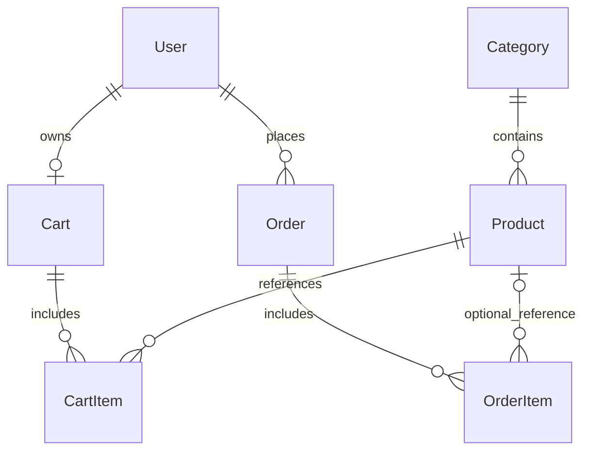

| 实体                   | 主要数据与关系                                       |
| ---------------------- | ---------------------------------------------------- |
| `User`                 | Django 用户模型，`is_staff` 区分管理员身份           |
| `Category` / `Product` | 分类、价格、库存、图片和上架状态；分类与商品为一对多 |
| `Cart` / `CartItem`    | 用户与购物车一对一；条目记录商品和数量               |
| `Order`                | 订单号、归属用户、总金额、状态、创建时间及支付时间   |
| `OrderItem`            | 订单商品快照，以及可为空的原商品引用                 |

## 演示流程

启动服务后，准备一个普通用户、一个管理员、一个商品分类，以及有库存的上架商品。建议按以下顺序查看：

| 步骤 | 页面与操作                                     | 可观察到的结果                                   |
| ---- | ---------------------------------------------- | ------------------------------------------------ |
| 1    | 首页搜索、分类、排序，进入商品详情             | 筛选结果、商品信息、价格与库存                   |
| 2    | 普通用户登录，添加商品并调整数量               | 购物车金额与导航数量同步                         |
| 3    | 从购物车创建订单                               | 生成待支付订单，购物车清空，商品库存扣减         |
| 4    | 取消一笔待支付订单                             | 状态变为已取消，库存恢复；再次取消被状态校验阻止 |
| 5    | 新建订单并模拟支付                             | 状态变为已支付，详情显示支付时间                 |
| 6    | 管理员查看订单并发货，再由订单所属用户确认收货 | 订单依次进入已发货、已完成状态                   |
| 7    | 管理员新增、编辑或上下架商品                   | 管理列表与商城展示按商品状态变化                 |

超时取消可单独演示：保持 Redis 和 Celery Worker 运行，创建订单后不支付，等待超时任务执行并检查订单与库存。未提供公开在线演示地址或预置账号，演示需在本地环境完成。

## 本地运行

完整步骤见 [运行与部署指南](docs/SETUP.md)，包含环境变量、数据库初始化、Redis 网络、容器与本地 Python 两种方案，以及 API 路径和故障排查。

环境要求：Node.js 22.12+（22 系列或更高受支持版本）、npm、Git，以及可访问的 PostgreSQL 和 Redis。Docker 方案使用 Docker Desktop；本地 Python 方案与现有 Dockerfile 的 Python 3.14 环境对应。

```powershell
# 首次安装前端依赖
cd frontend
npm ci
npm run dev

# 验证与生产构建
npm test
npm run build
```

默认前端地址为 [http://localhost:5173](http://localhost:5173)，API / 媒体入口为 [http://localhost:8080](http://localhost:8080)。前端可以独立构建；展示商品和购物流程需要后端服务与数据就绪。

生产部署需额外配置前端静态托管、Vue Router History 回退，以及 API 和媒体代理；现有 Compose 不会自动构建或托管前端。

## 验证范围

| 项目                   | 当前情况                                                                                             |
| ---------------------- | ---------------------------------------------------------------------------------------------------- |
| 前端工具测试           | 7 项单元测试，覆盖媒体 URL、数组响应、完整分页、认证头与参数保留、API 来源、空页、重复分页及失败传播 |
| 前端生产构建           | `npm run build` 已通过，页面采用路由懒加载                                                           |
| 浏览器检查             | 已检查桌面、390 px 与 320 px 布局，以及导航和表单                                                    |
| 前端交互验证           | 使用隔离内存接口验证注册校验、登录返回、筛选排序、购物车、下单、模拟支付、管理员入口和错误重试       |
| 后端自动化测试         | 各 Django 应用的 `tests.py` 当前仍为模板，尚未形成业务测试集                                         |
| 真实服务联调与并发验证 | 本次前端验证未运行真实 PostgreSQL / Redis / Celery 联调，未提供并发压测数据                          |

单元测试代码见 [frontend/tests/data.test.mjs](frontend/tests/data.test.mjs)。前端模拟接口验证与后端业务正确性验证分别记录，避免将界面流程检查等同于完整端到端测试。

## 当前取舍与后续方向

| 当前取舍                                    | 后续方向                                                                                         |
| ------------------------------------------- | ------------------------------------------------------------------------------------------------ |
| 使用模拟支付和状态发货                      | 对接真实支付通知、退款与物流查询，补齐相应的验证和补偿流程                                       |
| 全量读取列表后进行前端排序与分页            | 增加服务端排序和分页能力，减少大商品库的请求与内存开销                                           |
| 访问令牌存储于 localStorage，未接入自动刷新 | 完善令牌生命周期与失效交互，结合部署方案调整存储策略                                             |
| 事务提交后直接向 Redis 投递延迟任务         | 补充消息投递失败的重试、监控与补偿；必要时引入事务消息表，缩小数据库提交与任务投递之间的失败窗口 |
| 关键流程已有事务与锁，缺少业务测试          | 优先补充库存竞争、支付与取消竞争、重复取消、越权访问及任务重复执行测试                           |
| 后端仍通过 Django `runserver` 运行          | 补齐生产服务进程、HTTPS、静态资源、健康检查与持续集成                                            |

以上为后续规划，当前实现与验证范围以本仓库源码及上表为准。

## 代码导航

```text
ShopHub/
├── frontend/               # Vue 商城、账号、购物车、订单与商品管理
│   ├── src/services/       # 请求、媒体与分页处理
│   ├── src/router/         # 页面与访问引导
│   ├── src/views/          # 业务页面
│   └── tests/              # 前端工具测试
├── products/               # 分类、商品、上下架与图片校验
├── users/                  # 注册、JWT 登录入口与用户资料
├── cart/                   # 购物车与数量校验
├── orders/                 # 订单、状态操作、取消服务与超时任务
├── config/                 # Django、PostgreSQL、Celery 配置
├── nginx/                  # API 反向代理与媒体服务
├── docs/SETUP.md            # 安装、配置、API、部署与排查
├── docs/screenshots/        # 界面预览
├── docker-compose.yml      # 后端、任务进程与 Nginx 编排
└── requirements.txt        # 后端依赖
```

本地环境变量、数据库、上传媒体、依赖目录和构建产物不纳入提交。仓库尚未附带正式开源许可证；如需分发或复用，请先明确授权方式。
